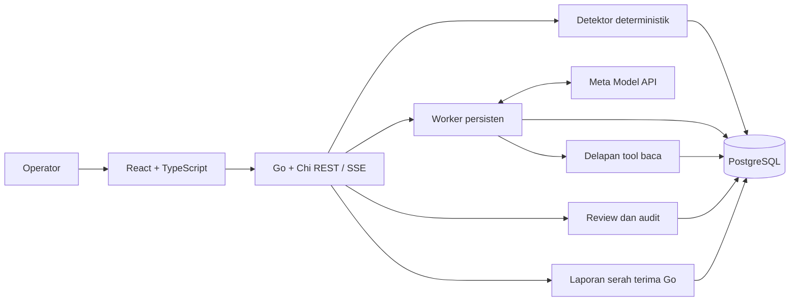

# Arsitektur OpsMind AI

## Komponen

Go 1.27.3 + Chi menyediakan HTTP, context cancellation, satu binary dan slog. pgx memakai SQL eksplisit; PostgreSQL 18 menyediakan transaksi, relasi, antrean dan checkpoint tanpa Redis. golang-migrate menjalankan migrasi berurutan. React/TypeScript/Vite/Tailwind membentuk workspace investigasi; TanStack Query menangani pengambilan dan invalidasi data. Docker Compose menyamakan lingkungan lokal. Pilihan Go dan Meta eksplisit mengesampingkan framework agent lain.

## Batas modul
domain: tipe, rekonsiliasi, uang dan deteksi; store: SQL dan transaksi; seed: simulasi; agent: adapter model, tool, evidence validation, budget dan worker; handover: pembentukan snapshot serah terima; httpapi: autentikasi, idempotensi, REST/SSE; web: empat tampilan investigasi dan workspace serah terima. Satu proses Go menyajikan frontend dan API pada origin yang sama. Model tidak memegang koneksi database dan tidak memiliki SQL atau tool tulis.

## Serah terima shift

P2 serah terima menambah modul `handover` dalam binary yang sama. Store membaca fakta dan review melalui transaksi PostgreSQL repeatable-read/read-only; builder Go membuat laporan tanpa model. Snapshot disimpan immutable bersama audit dalam transaksi tersendiri. Tidak ada scheduler baru: penyusunan otomatis atas permintaan operator. UI memakai cache per shift dan ID laporan; cetak/PDF melalui dialog browser.

## Ketahanan

investigation_runs adalah antrean. Satu worker memegang advisory lock PostgreSQL pada koneksi khusus; transaksi SKIP LOCKED memilih pekerjaan queued atau lease kedaluwarsa. Heartbeat memperbarui lease 60 detik setiap 15 detik. Transcript dan hasil tool disimpan setelah setiap langkah. Pembatalan eksplisit menghentikan context; putus browser hanya memutus SSE. Crash sebelum hasil panggilan eksternal tersimpan dapat menyebabkan panggilan ulang dan biaya ganda; anggaran tetap direservasi dan retry dibatasi. Tidak mengklaim exactly-once untuk API model.

## Keamanan
Satu akun operator dari environment, bcrypt/password minimal 12 karakter, cookie signed HttpOnly dan Secure di HTTPS, SameSite Strict, umur 8 jam. Operasi tulis memeriksa Origin; login memiliki pembatasan laju tersendiri. Idempotency-Key terikat operator, rute dan hash payload. Evidence dibatasi kasus dan scope shift. Source text diperlakukan sebagai data tidak tepercaya. Tidak ada rahasia pada frontend, log, atau repository. Audit append-only; persetujuan rekomendasi tidak mengubah data bisnis.

## Deployment
Render Free Docker web service + Neon Free PostgreSQL; tidak membeli layanan atau domain. Frontend dibangun pada tahap Node, backend pada tahap Go. Migrasi memakai lock; seed hanya eksplisit atau SEED_IF_EMPTY. Semua state di PostgreSQL, bukan filesystem container. Render dapat tidur setelah 15 menit tanpa inbound traffic; pemulihan terjadi saat bangun, bukan janji pemrosesan 24/7. Cold start dan kuota gratis dijelaskan kepada juri. Cadangan: Docker Compose dan rekaman dengan label yang benar.

Sumber diverifikasi 27 Oktober 2026: https://go.dev/dl/ ; https://render.com/docs/free ; https://neon.com/pricing ; https://dev.meta.ai/docs/overview .
