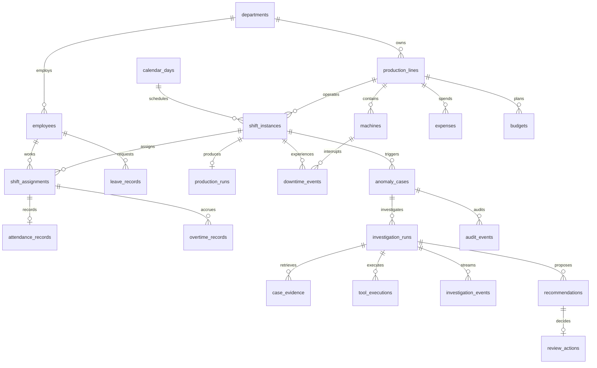

# Desain Database

PostgreSQL 18. PK teks deterministik untuk data sintetis dan UUID acak aplikasi. FK mencegah orphan; operasi bisnis memakai transaksi. BIGINT untuk IDR, timestamptz untuk instan, date untuk tanggal operasional. JSONB hanya untuk transcript, hasil terstruktur dan snapshot, bukan pengganti relasi operasional.

## Tabel dan integritas
16 tabel wajib: departments, employees, production_lines, shift_assignments, attendance_records, leave_records, overtime_records, production_runs, downtime_events, expenses, budgets, anomaly_cases, investigation_runs, case_evidence, review_actions, audit_events. Tambahan: machines, calendar_days, shift_instances, investigation_events, tool_executions, recommendations. Tabel teknis api_idempotency menyimpan replay respons dan budget_reservations menyimpan biaya maksimum/aktual per panggilan.

Shift dan interval memiliki CHECK end > start. Satu assignment per employee/shift; query seed dan uji memastikan tidak ada shift pekerja overlap. Satu attendance per assignment. Observed output, target, biaya dan durasi tidak negatif. Punch tidak lengkap diperbolehkan untuk menguji missing data; keduanya terisi harus berurutan. Relasi mesin/lini dan assignment/employee dicek backend serta seed. Deteksi unik (rule_id, entity_id, period_start, rule_version); hanya satu run aktif per kasus. Review unik per rekomendasi dan hanya berlaku pada laporan terbaru yang berhasil divalidasi.

case_evidence menyimpan snapshot kanonik, hash SHA-256, daftar SourceRef bertipe, case_id/run_id dan scope shift. Referensi polimorfik sumber divalidasi backend melalui allowlist tabel dan ID, bukan diklaim sebagai FK lintas tabel. Evidence, recommendation dan review memiliki FK nyata ke kasus/run. Indeks penting: shift(line_id, starts_at); assignment(employee_id, shift_id); run(status, lease_until); event(run_id, id); evidence(case_id, run_id); expense(line_id, occurred_at); audit(case_id, created_at).

## Migrasi
000001: data operasional dan constraint. 000002: kasus, antrean, event, tool, evidence, rekomendasi, review, audit, idempotensi dan budget. Pasangan up/down; rollback menghapus dari dependensi paling bawah. Migrate memakai advisory lock. Seed Go terpisah, transactional, reproducible dan berhenti jika dataset sudah terisi. Tidak mereset database melalui endpoint. Tidak menyimpan ground truth di database aplikasi.
